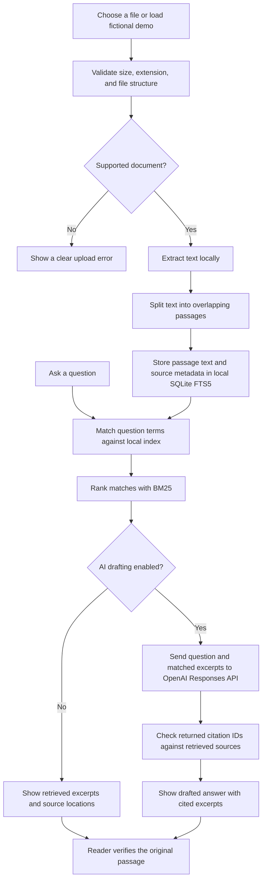

# Document Intelligence Copilot

<p align="center">
  <strong>Ask questions across your documents. Follow every result back to its source.</strong>
</p>

<p align="center">
  <a href="https://github.com/Ronakrai0001/document-intelligence-copilot/actions/workflows/ci.yml"></a>
  <a href="LICENSE"></a>
  
  
</p>

Document Intelligence Copilot is an open-source, local-first document search and question-answering app. Upload a PDF, Word document, Markdown file, or text file; find relevant passages; and, if you choose, draft an answer with citations to those passages.

**Try it without an API key:** run the app and select **Load the fictional demo handbook**. Ask the suggested question, then inspect the returned excerpt and passage reference.

> **Project status:** portfolio-ready v0.1. It runs locally and in Docker, includes tests and CI, and is designed for one trusted local user. It is not a hosted multi-user service. Do not expose it to the public internet without adding authentication, tenant isolation, and operational controls.

## How it works



| Step | What happens | Where data goes |
| --- | --- | --- |
| Upload | Validate `.pdf`, `.docx`, `.txt`, or `.md` (20 MB max per file) and extract text | File is processed on the app host; original upload is not kept |
| Index | Preserve PDF page numbers, split text into overlapping passages, and index with SQLite FTS5 | Local `data/index.sqlite3` |
| Retrieve | Match question terms and rank passages using BM25 | Local SQLite; no API call |
| Draft (optional) | Ask an OpenAI model to answer from the retrieved passages and cite their IDs | Only when enabled: question + matched excerpts go to OpenAI |
| Verify | Inspect the cited excerpt and page/passage location | You decide whether the evidence supports the answer |

## Run it in two minutes

### Docker (recommended)

Install Docker Desktop or Docker Engine with the Compose plugin, then from the repository folder:

```bash
docker compose up --build
```

Open <http://127.0.0.1:8000>. Compose binds the app to localhost and persists the index in a named volume. Stop it with `Ctrl+C`; use `docker compose down` to stop and remove the container while keeping the named volume. Use `docker compose down -v` only if you also want to delete the local document index.

For optional AI in Docker, copy `.env.example` to `.env`, add your key to that local ignored file, then start Compose. Keep the AI switch off for local-only question answering.

### Python

Python 3.11 or later:

```bash
python -m venv .venv
# macOS/Linux
source .venv/bin/activate
# Windows PowerShell: .\.venv\Scripts\Activate.ps1
python -m pip install -r requirements.txt
uvicorn app.main:app --host 127.0.0.1 --port 8000
```

Open <http://127.0.0.1:8000>. To store the index elsewhere, set `DOCS_DATA_DIR` to a local writable directory before starting the app.

### Optional AI answers

Local retrieval works without an AI key. To enable AI drafting, set `OPENAI_API_KEY` in the process environment; `OPENAI_MODEL` can select a model enabled for your account. For example, in PowerShell:

```powershell
$env:OPENAI_API_KEY = "your-key"
$env:OPENAI_MODEL = "gpt-6-luna"
uvicorn app.main:app --host 127.0.0.1 --port 8000
```

Turn on **Use AI to draft an answer** for each question. The app displays what will be sent before you ask. The OpenAI API may incur charges, and model availability varies by account. Never commit a real API key. AI answers can be wrong: check the linked passages.

## Features

- **Four formats:** PDF, DOCX, Markdown, and UTF-8 text.
- **Traceable retrieval:** PDF page citations; passage citations for the other formats; visible excerpts for every result.
- **Local by default:** FTS5/BM25 keyword search does not call an external service.
- **Optional synthesis:** OpenAI Responses API, enabled per question, with retrieved-source ID validation.
- **Useful first run:** one-click fictional handbook demo, with a sample question ready to ask.
- **Manage your library:** duplicate detection, file metadata, and deletion of a document plus its index entries.
- **Practical safeguards:** upload limits, file-format checks, sanitized names, SQLite parameterized queries, and safe text rendering in the browser.
- **Runnable and checked:** Docker Compose setup, API and extraction tests, and GitHub Actions CI.

## Design and implementation

The original project brief asked for document ingestion, retrieval, and answers with traceable citations. The implementation keeps the first version small enough to run locally without a vector database or paid model account:

- [FastAPI](https://fastapi.tiangolo.com/) serves the web UI and JSON API.
- [PyMuPDF](https://pymupdf.readthedocs.io/) extracts selectable PDF text while retaining page numbers; `python-docx` extracts Word paragraphs.
- Text is normalized into passages of about 950 characters with 120 characters of overlap. PDF pages are chunked separately so citations keep their page context.
- [SQLite FTS5](https://www.sqlite.org/fts5.html) stores searchable passage text. Query tokens are matched locally and FTS5's BM25 rank orders results.
- The optional AI path uses the [OpenAI Responses API](https://platform.openai.com/docs/api-reference/responses). It receives the question and retrieved passages, not the original files. Unknown source IDs or answers without a citation are rejected. This is a citation-format guard, not proof that a claim is entailed by its citation.

## API

Interactive API documentation is available at <http://127.0.0.1:8000/docs> while the app is running.

| Method | Route | Purpose |
| --- | --- | --- |
| `GET` | `/api/health` | Health and local AI configuration status |
| `GET` | `/api/documents` | List indexed document metadata |
| `POST` | `/api/documents` | Index one multipart upload in the `file` field |
| `POST` | `/api/demo` | Add the bundled fictional handbook to the library |
| `DELETE` | `/api/documents/{id}` | Delete a document and its indexed passages |
| `POST` | `/api/ask` | Retrieve sources and optionally request an AI draft |

Example local retrieval request:

```json
{"question":"How many days do I have to submit a travel claim?","top_k":5,"use_openai":false}
```

## Test and evaluate

```bash
python -m pip install -r requirements-dev.txt
ruff check app tests
python -m unittest discover -v
```

The tests cover file extraction, PDF page preservation, chunking, duplicate detection, FTS retrieval and deletion, HTTP upload/search flows, optional-AI configuration, citation validation, and the served UI. GitHub Actions runs the suite on pushes and pull requests. Human-readable sample questions are in [`evals/README.md`](evals/README.md); sample content is fictional in [`samples/sample-handbook.md`](samples/sample-handbook.md).

## Privacy, security, and limitations

- This is a single-user local application. The Docker setup publishes only on `127.0.0.1`; keep that restriction unless you add authentication, authorization, tenant-separated storage, CSRF protections, and abuse controls.
- Original files are read and discarded. Extracted text and metadata persist in the local SQLite index until you delete a document or remove the index/volume.
- Optional AI drafting transfers the question and matched excerpts to OpenAI. The default path uses local retrieval only.
- Scanned PDFs have no selectable text; OCR is not included. Search is lexical, not semantic. Image content, tables, DOCX headers/footers, and embedded objects are not fully indexed.
- Limits reduce accidental resource exhaustion, but do not make this a hardened public upload service. Only index files you trust.
- Never put real customer or employer documents in a public demo. Use the bundled fictional handbook for presentations.

## Contributing

Issues and pull requests are welcome. Start with the scope and test commands above; keep changes small and include a test for non-trivial behavior. See [`CONTRIBUTING.md`](CONTRIBUTING.md) and [`SECURITY.md`](SECURITY.md).

## License

The application is licensed under the [MIT License](LICENSE). Copied Ponytail repository guidance remains under its own included MIT license at [`.agents/skills/ponytail/LICENSE`](.agents/skills/ponytail/LICENSE); it is guidance, not an application dependency.
